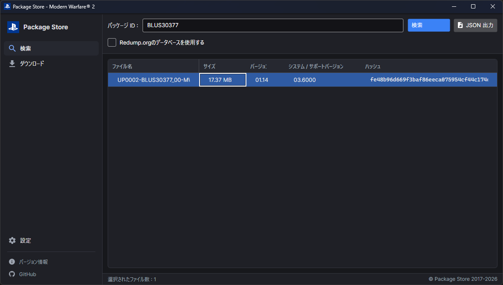

  

  <h3 align="center">PackageStore</h3>

  
PS Store (CD-only) package search tool

  

    <a href="https://github.com/coreizer/PackageStore/issues">Report Bug</a>
    ・
    <a href="https://github.com/coreizer/PackageStore/issues">Request Feature</a>
  

  
Table of Contents

  <ol>
    <li><a href="#👀-featured">Featured</a></li>
    <li><a href="#🖼️-screenshot">Screenshot</a></li>
    <li><a href="#🙏-acknowledgements">Acknowledgements</a></li>
    <li><a href="#👷-author">Author</a></li>
    <li><a href="#🌏-stay-in-touch">Stay In Touch</a></li>
    <li><a href="#⚖️-license">License</a></li>
  </ol>

## 👀 Featured

## 👀 Featured
- Package Search
- Simple Download Manager
- Search history
- Package ID completion using the Redump database
- Multilingual support: English, Japanese (form only)

## 🖼️ Screenshot

## 🙏 Acknowledgements
- [PS3 Developer Wiki - Environments](https://www.psdevwiki.com/ps3/Environments)
- [ByteSize - Utility](https://github.com/omar/ByteSize)
- [redump.org](http://redump.org/)
- [AngleSharp](https://github.com/AngleSharp/AngleSharp)
- [Enums.NET](https://github.com/TylerBrinkley/Enums.NET)
- [Fody](https://github.com/Fody/Fody)

## 🌏 Stay In Touch
- [Website (coreizer.dev)](https://www.coreizer.dev)
- [X](https://www.x.com/coreizer)

## 👷 Author
- coreizer

## ⚖️ License

This project is licensed under [GPL v3.0](https://opensource.org/license/lgpl-3-0/). See [License File](LICENSE) for details.

---

